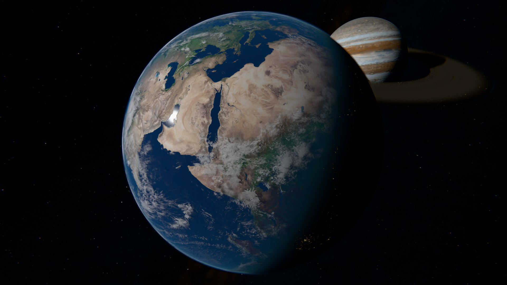
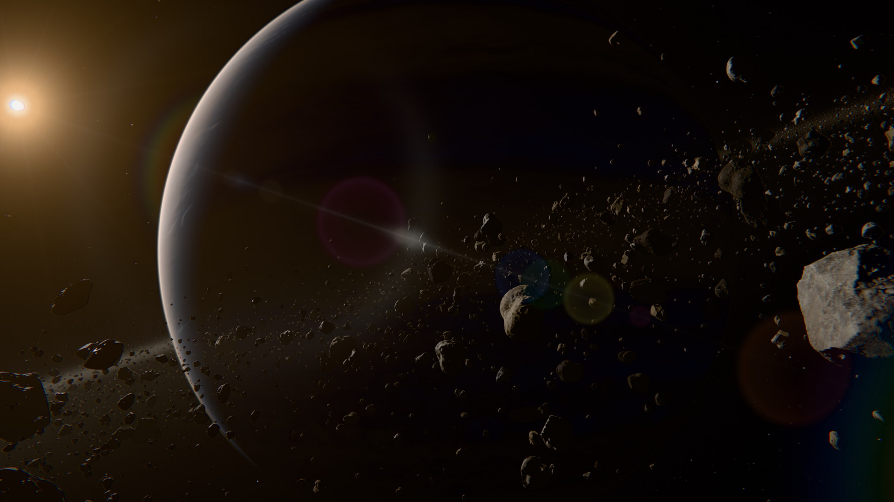
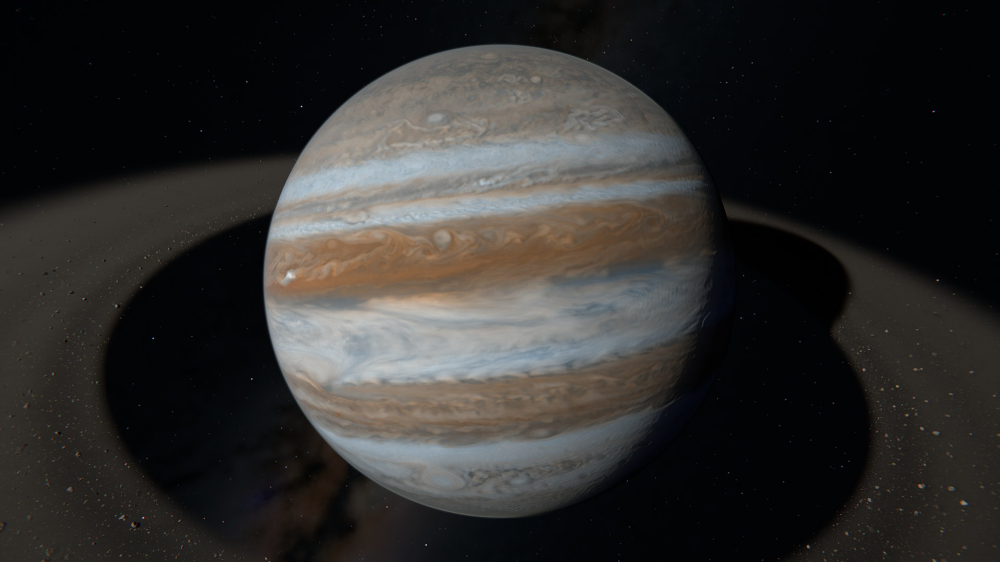
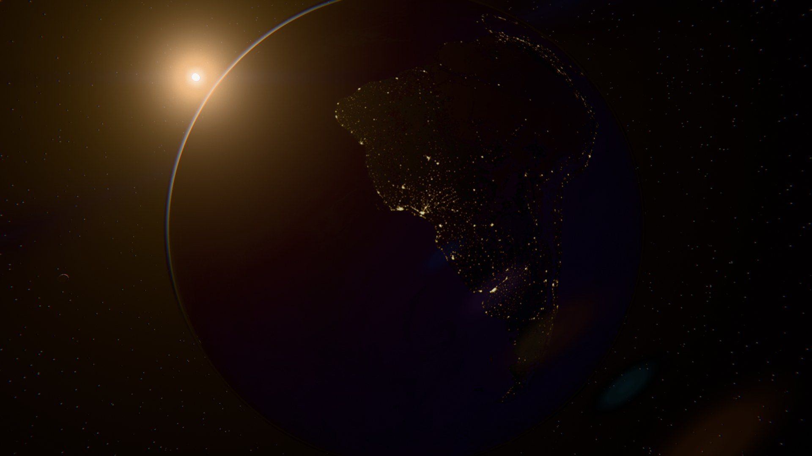
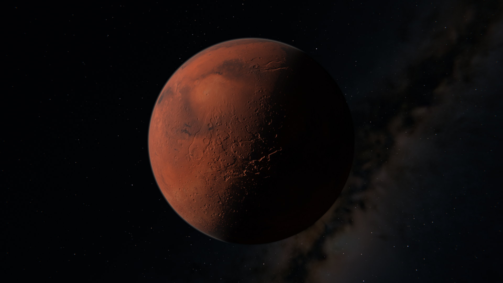
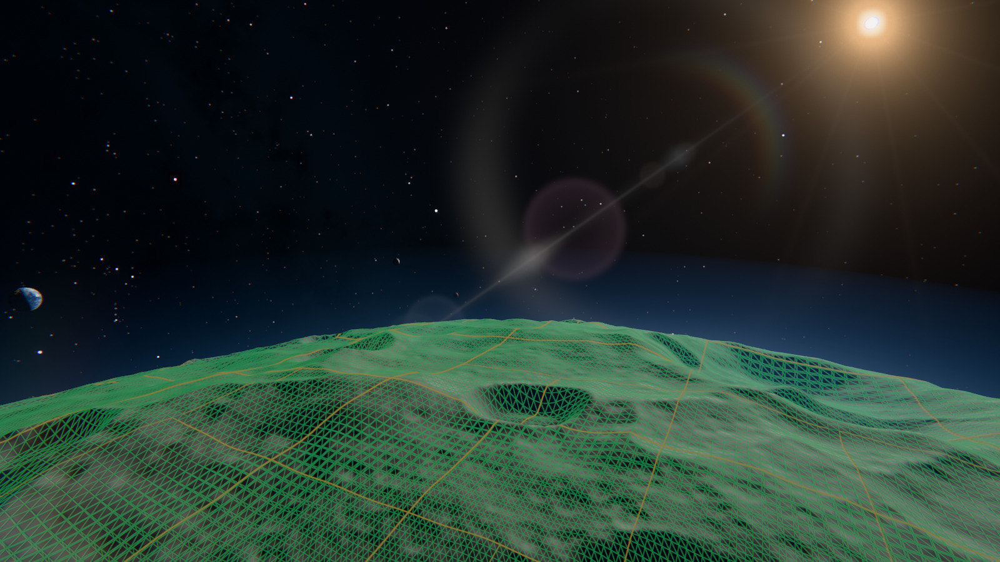

# ORBITAL

C++20 space demo on a compatibility fork of [NoGraphicsAPI](https://github.com/sebbbi/NoGraphicsAPI): an Earth-like world, a gas giant with an asteroid belt, a rocky moon, a desert world with two small moons, and a minor planet whose surface is generated as you approach it.



|  |  |
| --- | --- |
|  |  |

## Details

Sourced material maps, atmospheric scattering, shadows, HDR with exposure adaptation and bloom, temporal plus SMAA anti-aliasing, CDLOD and a Dear ImGui control panel.

The asteroid belt is a deterministic rock population drawn as meshes near the camera and splats further out, with its own transmittance and extinction maps, forward-scattering dust and a lit disc. The sky is the Milky Way fitted as splats over a star catalogue.

The minor planet carries a second terrain tier. Close in it stops being a textured sphere and becomes a CDLOD cube sphere: one shared grid mesh instanced per patch, shape and colour read from per-patch tiles that a CPU worker pool generates and streams into texture arrays, levels meeting without cracks by vertex morphing.



## Build

Windows requires x64, MSVC C++ tools, CMake 3.25+, Ninja and Vulkan headers/loader import library (normally Vulkan SDK). NoGraphicsAPI is vendored under `third_party/NoGraphicsAPI`.

```powershell
./tools/bootstrap.ps1
./tools/build.ps1 -Preset release
ctest --preset release
./build/release/orbital.exe
```

Bootstrap downloads pinned shader tools; it does not install a GPU driver or full Vulkan SDK. Material textures are tracked in git as PNG; `tools/import-assets.ps1` records and reproduces their derivation from the upstream sources. Machine-specific overrides (for example an existing Vulkan loader library) go in an ignored `CMakeUserPresets.json`; in an MSVC developer shell, `cmake --preset <your-preset>` then `cmake --build --preset release`.

Shaders are Slang, compiled offline, with a shared C++/shader layout header. See [docs/FOUNDATION.md](docs/FOUNDATION.md) for the compatibility backend.

For Linux setup, build presets, validation and SSH launch instructions, see [Linux](docs/LINUX.md).

## Explore

RMB + mouse looks around; holding the middle button is a 5x telescope; WASD flies, Q/E moves vertically, Shift accelerates and Z halves the travel speed for close work. Keys 1–9 select the bookmarked views: Earth, Jupiter, Moon, Mars, dawn, belt, the two dust views, and the minor planet. The tenth, the minor planet up close, is on the panel or `--bookmark 9`. T starts and stops the tour, O orbits the selected body, F returns to free flight. Space pauses the system; +/- changes exposure, X toggles adaptation. For terrain review, N toggles the near tier, G toggles its wireframe, V cycles the six patch views, and C freezes culling for inspection.

Tab opens the control panel (`--ui` opens it at start), which holds frame statistics and every toggle below. The hotkeys: F1 HUD, F2 quality tier, F3 belt transmittance map, F4 belt extinction, F5 temporal anti-aliasing, F6 rock splat cut-off (off, 1.2, 2.5, 4 px), F7 splat lighting in both culling passes, F8 tone curve (PBR Neutral, AgX, ACES filmic), F9 spatial anti-aliasing (off, FXAA, SMAA), F10 capture (captures/orbital-0001.png and on, never overwriting), F11 belt dust, Alt+Enter borderless fullscreen, Esc exit. Terrain controls (N, G, V, C) are grouped together in the Terrain section of the panel.
For very close glancing views, enable **Terrain > Surface inspection (noclip)**. This bypasses only the minor planet's camera clearance, allowing travel through its surface; turn it off to restore the normal limit. Use Z for slow travel.

```powershell
./build/release/orbital.exe --width 1920 --height 1080 --tour
./build/release/orbital.exe --bookmark 5 --time 0 --frames 300 --high --benchmark belt.csv
./build/release/orbital.exe --bookmark 4 --time 0 --frames 60 --no-hud --capture captures/dawn.png
./build/release/orbital.exe --bookmark 5 --time 0 --frames 40 --pan 3 --spatial 0 --capture captures/pan.png
./build/release/orbital.exe --bookmark 9 --time 1200 --back 0.05 --frames 120 --no-hud --high --capture captures/minor-planet.png
```

`--help` lists every option.

The minor planet's tiles are generated at run time. `planet-forge --out assets/planets/minor-planet --levels 0..5` bakes the coarse levels into a tile store (`--check` reads every tile back against the generator; the directory is ignored by git), and `--planet-store assets/planets/minor-planet` makes a run read them, generating only the finer levels. That path is for testing the bake; the demo does not use a store unless asked.

`python tools/check.py` is the quick render check: every view in one process, diffed against an accepted reference. For repeatable scene/window/fullscreen measurements and comparisons against saved milestones, use [the performance suite](docs/PERFORMANCE.md).

## Repository layout

| Path | Contents |
| --- | --- |
| `src/core` | Logging, panic, file I/O and vector/matrix math shared by everything else |
| `src/platform` | OS-neutral window, input, process, text-overlay and ImGui-overlay interfaces; `win32/` and `linux/` implement them |
| `src/app` | Options, camera, HUD, control panel and the frame loop; no OS calls |
| `src/scene` | Deterministic system generation, rock population and mesh geometry |
| `src/assets` | PNG image I/O (Wuffs decode, stb write), SIMD pixel kernels and material mip-chain generation |
| `src/render` | The renderer on NoGraphicsAPI: resources and materials, per-frame passes, the terrain tier's GPU side (tile arrays, staging rings, patch draws), GPU-side types |
| `planet/` | The planet libraries (docs/PLANET_FORGE.md): `common` (patch keys, cube sphere, tile vocabulary, store format, allocator), `gen` (procedural crater terrain, tile sampling, store reader and providers), `clod` (quadtree selection, tile cache, streamer), `cook` (store writer behind the `planet-forge` tool); graphics-API-free, depend on `src/core` only |
| `shaders/` | Slang shaders; `scene_shared.h` is the shared C++/shader layout |
| `tests/` | Executable-assertion tests run through CTest; `planet/tests` holds the planet libraries' suites |
| `tools/` | PowerShell scripts (bootstrap, asset import, build, format, GCC check, smoke and stability checks), Python tools (render and shader checks, benchmark suite, asset bakes, texture compression) and `planet-forge`, the minor planet's tile baker |
| `cmake/` | Slang shader compilation helper |
| `docs/` | Architecture, decisions, foundation, assets, terrain and code style ([index](docs/README.md)) |
| `third_party/` | Vendored NoGraphicsAPI fork with its patch against upstream, Dear ImGui, SMAA tables, Wuffs and stb_image_write ([details](third_party/README.md)) |


## License

The demo is released under the [MIT License](LICENSE). NoGraphicsAPI is MIT licensed (`third_party/NoGraphicsAPI/LICENSE`); Dear ImGui is MIT (`third_party/imgui/LICENSE.txt`); the SMAA lookup tables and reference shader are MIT-style (`third_party/smaa/LICENSE.txt`); Wuffs is Apache-2.0 OR MIT (`third_party/wuffs/LICENSE`) and stb_image_write is public domain (`third_party/stb/LICENSE`). Material textures are CC BY 4.0 (Solar System Scope), public domain NASA (the Cassini Jupiter map, the Moon and Mars elevation and colour data), the public-domain Yale Bright Star Catalogue, ESO's Milky Way panorama (CC BY 4.0, ESO/S. Brunier, fitted as splats) and CC0 (Poly Haven); provenance, hashes and attribution requirements are in [docs/ASSETS.md](docs/ASSETS.md) and `assets/materials/manifest.json`. The minor planet's surface is generated at runtime from its seed and carries no sourced material. Keep attribution with redistributed assets.

Optional material compression: build `texture_tools`, then run `python tools/compress-textures.py`.
The demo prefers valid caches supported by the GPU and otherwise loads source PNGs.
See [texture compression](docs/TEXTURE_COMPRESSION.md) for setup and per-texture overrides.
