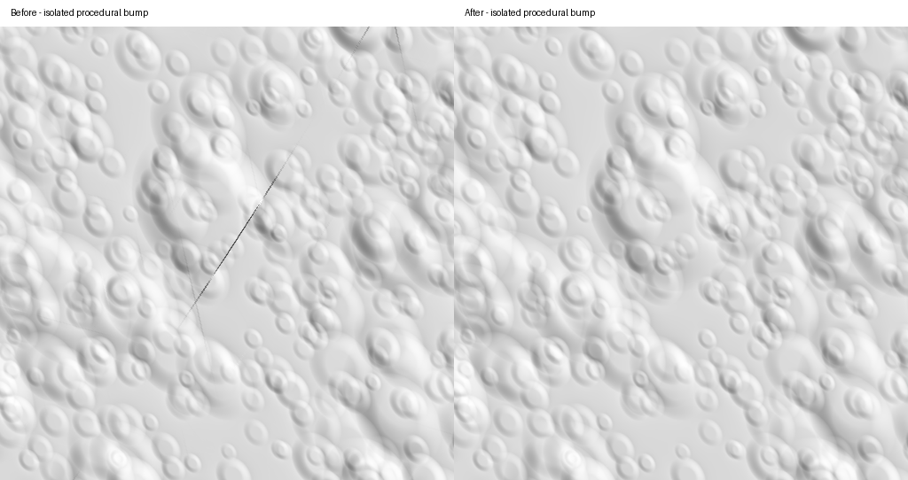

# Diagonal bump creases — 2026-10-25

The procedural micro-crater generator contained a reproducible discontinuity consistent
with the reported short, similarly oriented creases at close range. This is independent
of tile residency, eviction, mesh morphing and texture edges.

This is an offline rendering of the micro-detail slope field, not an in-game screenshot.
Both images use seed 1007, identical cube-face coordinates, sampling and directional
lighting. The straight diagonal cut disappears; curved crater rims remain.

## Cause and correction

The generator hashes a 3D lattice, jitters crater centres within cells, then projects
them onto the sphere. Its old 3x3x3 neighbourhood omitted craters whose projected
support reached the sample from a more distant cell. Crossing a lattice plane could
therefore abruptly add/remove part of a crater. Differentiation amplified that height
step into a sharp bump crease. Projected lattice planes need not align with tile edges.

The complete point query now searches 7x7x7 cells with conservative shell and tangent
rejection. Let `a = 1.4 + sqrt(3)/2` be the radial shell plus jitter bound, `f` the
lattice frequency, and `s = .34 * 1.4 * 2.2` the maximum crater support in lattice units.
For any contributing jittered position `q` and sample `p = f*d`,
`|q-p|² <= a² + (1+a/f)*s² < 3²`. Thus three cells in each direction suffice.
A compile-time assertion checks this bound at the lowest frequency.

The outer crater tail also fades smoothly to zero between 1.5 and 2.2 crater radii,
removing the former nonzero cutoff without softening the rim. Height and first
derivative vanish at the support boundary.

To avoid hashing the enlarged neighbourhood at every texel, colour-tile generation
prepares a conservative spherical-cap list of contributing craters once per tile,
including its derivative border. It evaluates the same profiles in the same order.
Tests compare this optimized path with the complete point query exactly across
six cube faces, three seeds, five levels and border samples.

Mesh heights, triangle budgets, texture dimensions and GPU cache allocations are
unchanged. Bump slopes change, and their contribution to albedo tint can change too.
Temporary CPU crater lists are local to tile generation.

## Measurements

The continuity probe samples both sides of lattice planes at offsets of ±1e-7
lattice units, across three axes and seeds 1007, 1008 and 2024 (58,176 pairs).

| Measurement | Before | After |
| --- | ---: | ---: |
| Pairs differing by more than 1e-8 body radii | 17,996 | 0 |
| Maximum absolute difference, body radii | 3.4115e-4 | 2.9395e-9 |

Increasing the offset 100 times gives roughly 100 times the corrected difference,
as expected for a continuous field. Previously the worst steps stayed nearly constant.
These are finite-distance comparisons, not a claim of mathematically zero slope.

Raw data: [before](data/terrain-bump-continuity-before-2026-10-25.csv),
[after](data/terrain-bump-continuity-after-2026-10-25.csv).

GCC Release generation benchmark, seed 1007, four tiles per level, warmed up,
at least one second per row, sequential before/after runs on this machine:

| Colour tile level | Before, ms/tile | After, ms/tile |
| --- | ---: | ---: |
| 3 | 15.05 | 22.38 |
| 5 | 20.61 | 25.27 |
| 7 | 19.19 | 13.24 |
| 9 | 19.59 | 11.99 |
| 11 | 19.42 | 11.87 |

The complete support costs more on coarse tiles; preparing crater lists makes the
close-range levels faster. These are CPU generation timings, not frame-rate results.
Height-tile checksums are identical before and after. Colour checksums match the
complete point-query implementation used before introducing the regional optimization.
Raw generation data: [before](data/terrain-bump-generation-before-2026-10-25.csv),
[after](data/terrain-bump-generation-after-2026-10-25.csv).

## Reproduction and regression coverage

Build the opt-in `terrain_detail` target. Running it without arguments emits the
continuity CSV; `terrain_detail --image bump.pgm` renders the diagnostic above.
`terrain_budget 1007 1000` emits the generation benchmark.

The terrain tests cover lattice-plane continuity, the zero tail cutoff, regional
query equivalence and existing cube-edge/corner slope agreement. The original
reported camera position was not supplied, so the exact in-game observation still
needs manual comparison; this reproduced generator defect is fixed.

Validation: MSVC Release build and all 18 tests passed; GCC portability build and
all 17 tests passed. A 120-frame headless bookmark-9 renderer smoke run at 960x720,
activation 100 and LOD bias +2 completed successfully.
